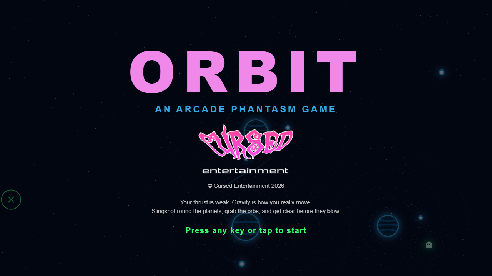
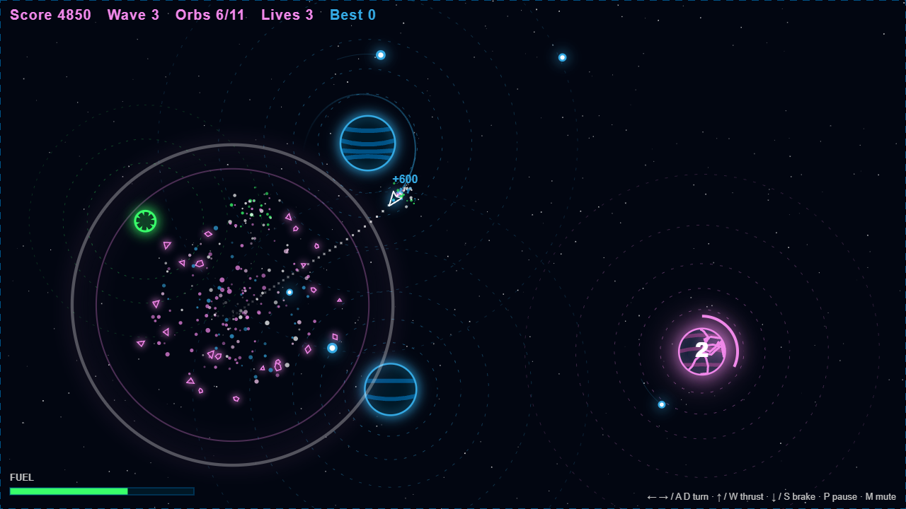

 

  

 

  
  
  

 

# ORBIT

**An [Arcade Phantasm](https://arcade-phantasm.netlify.app/) game** · **[Play it](https://cursedprograms.github.io/Orbit/)**

A tiny spacecraft caught between gravitational fields. Orbit planets to dodge enemies, slingshot between gravity wells and collect energy orbs, while planets explode around you.

**The twist:** enemies have their own gravity, pulling you off course.

  
  

## Versions

| Version | Where | Status |
|---|---|---|
| Browser | this folder, the repo root · **[Play it](https://cursedprograms.github.io/Orbit/)** | Playable |
| Windows exe | `cpp/` (build: `cpp/build.bat`) | Playable |
| Android | `android/` · [APK](android/apk/) | Playable |

## Windows exe

C++17 with SDL2, OpenGL 3, [Dear ImGui](https://github.com/ocornut/imgui) and [stb](https://github.com/nothings/stb). The same game as the browser one, with its sound effects made as it plays (no audio files). F11 fullscreen, Esc menu.

To build it: Visual Studio 2022 (C++) and CMake, then `cpp/build.bat` (or `build.ps1`; `build.sh` on Linux with SDL2 installed). It fetches SDL2 once into `cpp/external/`, builds `cpp/build/Release/Orbit.exe` and packs `cpp/dist/Orbit-win64.zip`.

## How to play

Every planet pulls on you (inverse square: the faint rings mark its well). Your thrust is weak and your fuel is short, so gravity is how you really move: fall round a planet, then slingshot to the next. The dotted line shows where you'll fall over the next couple of seconds, and a pink cross marks a crash ahead.

- **Energy orbs**: collect enough to clear the wave. Most ride an orbit round a planet: match it to catch one. Each orb tops up your fuel.
- **Ghosts** hunt you and pull you towards them with their own gravity (the green rings). From wave 3 come the maws, slow ghosts with deep wells, and from wave 4 the darters.
- **Planets explode**: a planet cracks, glows and counts down, then goes with a shockwave and flying debris, and its well is gone. Get clear. The blast, the shockwave and the debris destroy ghosts too, for points. New planets form in their place.
- Fuel slowly comes back when you're not burning. The arena's edge bounces you back in.

Each wave has more planets and more ghosts. You have three lives, and an extra one every second wave. Fuel left at the end of a wave adds to the bonus. Your best score is kept in the browser.

## Controls

| Key | Action |
|---|---|
| ← → or A D | Turn |
| ↑ or W | Thrust |
| ↓ or S | Brake (thrust against your motion) |
| P or Esc | Pause |
| M | Mute |
| Space or Enter | Fly again after game over |

On a phone: drag anywhere to steer and thrust towards the drag, BRAKE brakes, II pauses.

## Android

The browser game in an Android app: it plays offline, full screen in landscape, with the sound on from the start
(Android 7.0 or newer).

- **Download**: the APK in [`android/apk/`](android/apk/). Copy it to the phone and open it (allow installs from
  unknown sources when asked).
- **Build it**: the Android SDK and JDK 17, then `android/build.bat` (or `build.ps1`, `build.sh`). It runs
  `gradlew assembleDebug` and leaves the APK in `android/apk/`. The game's web files are copied into the app at build
  time, so the browser game at the repo root stays the only copy.
- **The code**: `android/app/src/main/java/com/synthwomb/orbit/MainActivity.kt`, a full-screen WebView that serves the
  game from the app's assets. Press Back twice to leave.

## Files

- `index.html`: the page
- `site/style.css`: the page's look
- `site/game.js`: the game: fixed-step gravity physics, the planets, the ghosts, the trajectory dots, the drawing
- `site/sfx.js`: the sound, made with Web Audio (no audio files)
- `images/`: the Cursed logo and the screenshots

Open `index.html#shot` for a mid-game screenshot.

## Also in the arcade

[KillerStardust](https://github.com/CursedPrograms/KillerStardust) · ProtocolHex · Seance · RicochetReaper · GraveDanger · [Vortex](https://github.com/CursedPrograms/Vortex) · **Orbit** · RocksOfRuin · Devourer

 

© Cursed Entertainment 2026

 

